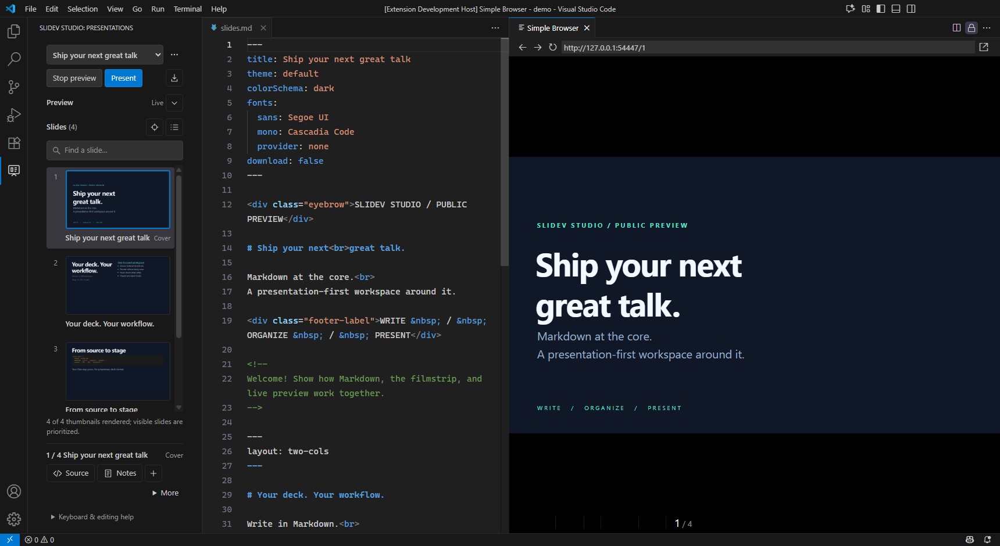

<p align="center">
  
</p>

<h1 align="center">Slidev Studio</h1>

<p align="center">Your Markdown. Your slides. One focused workspace in VS Code.</p>

<p align="center">
  <a href="https://github.com/kasuken/vscode-slidev-studio/actions/workflows/ci.yml"></a>
  <a href="LICENSE"></a>
  
  
</p>



Slidev Studio brings a presentation-first workflow to [Slidev](https://sli.dev):
choose a deck, browse its slides, edit Markdown, and present without leaving your
tools behind. It is standalone and can coexist with `antfu.slidev`.

## What you can do

- **Find your flow.** Switch between workspace decks, search slides, and browse
  rendered thumbnails or a compact outline.
- **See what you are making.** Start a local live preview and navigate it by
  selecting slides in the filmstrip.
- **Organize without losing source.** Add, duplicate, delete, or reorder local
  slides with Undo support. Shared imports move as intact groups; their source
  files are never deleted.
- **Polish the details.** Open presenter notes, choose installed-theme or local
  layouts, and insert workspace images.
- **Take the stage.** Open presenter mode or export PDF, PNG, and PowerPoint
  through your workspace's Slidev CLI.
- **Keep control.** Rendering requires workspace trust and an explicit action.
  No packages or browsers are installed automatically.

> [!IMPORTANT]
> This is an early public preview. Version-matched parsing and rendering support
> **Slidev CLI 52.14.2 and 53.0.0**. Other versions remain read-only and cannot
> start preview or export. Remote-host and broader accessibility/theme validation
> are still in progress.

## Get started

Requires **VS Code 1.104+**. Preview, presentation, and export also require a local
supported `@slidev/cli`, its dependencies, and the browser required by Slidev's
export feature.

1. Install the `.vsix` using **Extensions: Install from VSIX...** in VS Code.
   Build it locally using the development commands below, or download an
   available build from [GitHub Actions](https://github.com/kasuken/vscode-slidev-studio/actions).
2. Open your Slidev project folder.
3. Select the **Slidev Studio** activity-bar icon and choose a presentation.
4. Click **Start preview** in a trusted workspace.

Click a slide to select it; use **Source** or double-click to open its Markdown.
Arrow keys, Home, and End navigate the list. **Alt+Up/Down** reorders a slide or
an imported group. **+** inserts after the selection. **More** contains layout,
image, duplicate, delete, and move actions; **Notes** opens presenter notes.

> [!TIP]
> Collapse the preview to make more room for thumbnails. Switch to outline view
> for dense decks. Search by title, source path, or exact slide number; clear
> search before reordering.

## Deck discovery

By default, Studio finds `**/slides*.md` files with opening YAML headmatter.
Customize discovery for your workspace:

```json
{
  "slidevStudio.include": ["**/slides*.md", "talks/**/presentation.md"]
}
```

Imported fragments are not separate decks unless they match these patterns.
Multi-root workspaces are supported, and deck selection is saved per workspace.
Changes refresh on save, file operations, and configuration updates.

## Source stays the source of truth

The cover remains fixed. Local edits are single undoable workspace edits;
imported slides expose their provenance and shared-source warnings. Removing
an import removes only its reference from the current deck.

With a custom `setup/preparser.*`, Studio uses **Source outline** rather than
guessing transformed slide order. Original-source navigation and eligible local
edits remain available, but rendered thumbnails and source-to-preview
synchronization are disabled. Starting preview explicitly still runs Slidev,
including the preparser. Variables are not evaluated during discovery.

Preview/export errors appear in the sidebar and the **Slidev Studio** output
channel. Studio stops its managed processes on preview stop, deck changes,
extension deactivation, or view disposal (except an active presenter session).

## Development

Requires **Node.js 22.18+** and npm.

```powershell
git clone https://github.com/kasuken/vscode-slidev-studio.git
Set-Location vscode-slidev-studio
npm ci
npm run check
npm test
npm run test:host
npm run package
```

Packaging creates `vscode-slidev-studio-0.0.2.vsix`. Press **F5** and choose
**Run Slidev Studio** to open the sample workspace in an Extension Development
Host. The screenshot's public-safe deck and styles are in `docs/demo`; copy them
into an existing supported Slidev project to try the same presentation.

On Windows, use `npm.cmd` if PowerShell blocks `npm.ps1`. Restart VS Code after
installing Node if it is not found. The build task also checks the per-user
Node installation under `%LOCALAPPDATA%\Programs\nodejs`.

CI typechecks, runs unit tests, and packages on Windows, macOS, and Linux.
Extension Host tests verify dirty-buffer edits and single-step Undo, including
shared-reference duplication. They download pinned VS Code 1.104.0 on first run.
The runtime sidebar uses plain JavaScript/CSS and VS Code theme tokens; the
host uses TypeScript and version-matched Slidev parsers.

[Publishing](docs/PUBLISHING.md) · [Changelog](CHANGELOG.md) ·
[Implementation plan and validation gaps](docs/PLAN.md) · [MIT license](LICENSE)
